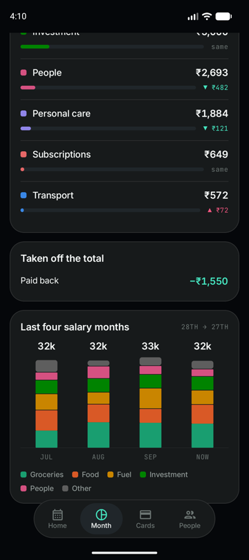
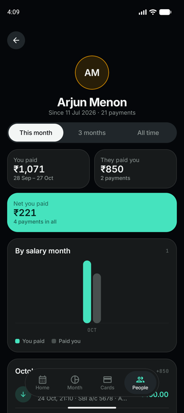

# Spend

**Your spending, straight from your bank SMS.** An Android app that reads the bank SMS your phone already gets and keeps one line in the notification shade:

> **Today ₹752 · Month ₹30,281**

No sign-up, no bank login, no internet permission. Everything stays on the phone.

<p>
  
  
  
  
</p>
<p>
  
  
  
  
</p>

<sub>Screenshots use built-in demo data. No real accounts or amounts.</sub>

## Download

- Grab **`Spend-v0.1.0.apk`** from [Releases](../../releases/latest)
- Android 12 or newer
- Allow "Install unknown apps" for your browser or file manager when asked

## Features

| | |
|---|---|
| 🔔 **Always-on notification** | Today and salary-month totals, refreshed the moment a bank SMS lands |
| 📅 **Day by day** | Every payment grouped by day, tap one to re-tag it |
| 🍩 **Categories** | Food, Groceries, Travel, Shopping, Bills, Medical, Rent, SIPs and more, from a built-in Indian merchant list |
| 💳 **Per card / account** | Spend split by card and account, matched on the last 4 digits |
| 👥 **People** | Friends merged across UPI IDs and bank names, with this month / 3 months / all time |
| 💰 **Salary month** | Month runs salary to salary, detected from your credit SMS |
| 🏠 **Rent detection** | Spots the monthly transfer to the same person, or mark any payment as rent |
| ↩️ **Refunds & reimbursements** | Money coming back reduces your spend |
| 🔁 **No double counting** | Card bill payments, transfers between your own accounts and repeated SMS are ignored |
| ✍️ **Cash entries** | Add spends that never hit a bank SMS |
| 📤 **CSV export** | Full ledger to `Download/Spend/` |
| 🌙 **Dark UI** | Built for OLED, custom charts |

## Privacy

- ❌ No `INTERNET` permission: the app **cannot** send data anywhere
- ❌ No accounts, analytics, ads or crash reporters
- ❌ Backup disabled: your ledger isn't copied to the cloud
- ✅ Reads only SMS from bank sender IDs; promos and OTPs are skipped
- ✅ Nothing is hardcoded: your accounts, name and salary day are detected on the phone, and you confirm them

## Supported banks

| Bank | UPI | Card spend | Card bill | Credits / salary |
|---|:-:|:-:|:-:|:-:|
| HDFC | ✅ | ✅ | ✅ | ✅ |
| SBI | ✅ | ✅ | ✅ | ✅ |
| ICICI | | ✅ | ✅ | |
| DCB | ✅ | ✅ | | ✅ |

Other banks' SMS show up under **More → Unparsed** so new layouts are easy to add.

## How it works

```
Bank SMS ──► SmsReceiver ──► SQLite (raw SMS only)
                                  │
                                  ▼
             SmsReader ──► Classifier ──► Dedupe ──► Ledger
             (layouts)     (merchant,     (bills,     (today, salary month,
                           person, self)   repeats)    categories, cards)
                                  │
                                  ▼
                    Notification  +  Compose UI
```

- Raw SMS are stored once; every total is recomputed from them, so fixing a parser fixes history too
- Your own accounts, name and UPI IDs are learned from transfers between them

## Battery

- No polling, no wake locks
- Wakes only when an SMS arrives, plus one inexact alarm at midnight to reset "Today"
- The notification service sits idle between SMS

## Build

Requirements: Android Studio (JDK 17+), Android SDK 37.

```bash
git clone https://github.com/DdarkSaber/Spend.git
cd Spend
./gradlew assembleDebug        # app/build/outputs/apk/debug/
./gradlew testDebugUnitTest    # parser, classifier, people, rent tests
```

Release signing reads an untracked `keystore.properties`:

```properties
storeFile=/path/to/release.jks
storePassword=...
keyAlias=...
keyPassword=...
```

Without it, `assembleRelease` still builds, just unsigned.

## Stack

- Kotlin, Jetpack Compose, Material 3
- Plain SQLite, no ORM
- Hand-drawn Canvas charts, no chart library
- Fonts: [Inter](https://rsms.me/inter/) and [JetBrains Mono](https://www.jetbrains.com/lp/mono/) (SIL OFL)

## License

[MIT](LICENSE). Fonts are under the SIL Open Font License; see `FONT-LICENSE-*.txt`.
