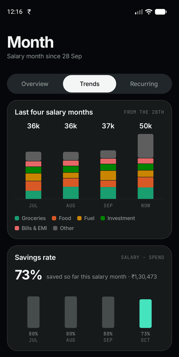
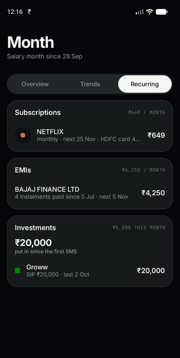
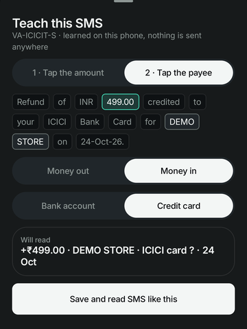
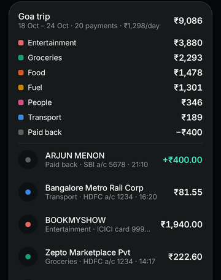
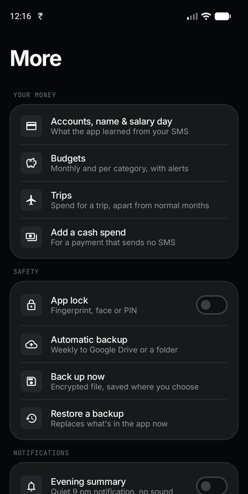
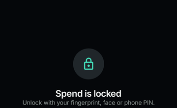

# Spend

**Your spending, straight from your bank SMS.**

An Android app that reads the transaction SMS your bank already sends, and keeps one line in the notification shade:

> **Today ₹752 · Month ₹30,281**

No sign-up · no bank login · no internet permission · everything stays on the phone.

[](https://github.com/DdarkSaber/Spend/actions/workflows/build.yml)
[](../../releases/latest)
[](LICENSE)

---

## Download

1. Get **`Spend-v0.3.0.apk`** from [Releases](../../releases/latest)
2. Android 12 or newer; allow "Install unknown apps" when asked
3. Open it, tap **Grant permissions**. Your last 120 days of bank SMS are read once

> SMS greyed out? Android restricts it for apps outside the Play Store: **App info → ⋮ → Allow restricted settings**, then grant again.

---

## What it does

**Track**

| | |
|---|---|
| 🔔 **Always-on notification** | Today and salary-month totals, updated the moment a bank SMS lands |
| 📅 **Day, month, year** | Calendar, category donut, pace vs last month, 12-month view |
| 💰 **Salary month** | Runs salary to salary; savings rate per month |
| 🧹 **No double counting** | Card bills, transfers between your own accounts and repeated SMS are left out |
| 🔍 **Search & tags** | Find by payee, amount, card or tag; tag any payment ("office", "gift") |

**Plan**

| | |
|---|---|
| 💳 **Card utilisation** | % of each limit used, and *"pay ₹X before the statement date to stay under 30%"* |
| ⏰ **Bill reminders** | From the statement SMS: 3 days before and on the due day, skipped once paid |
| 🎯 **Budgets** | Monthly and per category; alerts at 80%, 100% and when you're ahead of pace |
| 🔁 **Recurring** | Subscriptions (with price-rise alerts), EMIs and investments, each in one list |
| ✈️ **Trips** | A trip's dates (plus anything tagged with its name), apart from normal months |

**People**

| | |
|---|---|
| ➗ **Split a payment** | Equal or custom, with People or contacts; only your share counts |
| 🤝 **Owed to you** | Splits and loans per person; cleared when they pay you back by UPI |
| 👥 **One person, many IDs** | Friends merged across UPI IDs and bank names |

**Safety & control**

| | |
|---|---|
| 🚨 **Worth a look** | Double charges, unusually large payments, foreign-currency charges |
| 🧠 **Teach an SMS** | Tap the amount and payee in an unread SMS; Spend reads that shape from then on (on the phone, no AI, no internet) |
| 🔒 **App lock** | Fingerprint, face or phone PIN; hidden from the recent-apps preview |
| ☁️ **Weekly backup** | Encrypted, to Google Drive or a folder you pick; restore on a new phone |
| 🌙 **Evening summary** | Optional quiet 9 pm notification with today's spend |
| 🧩 **Widget & themes** | Home-screen widget; dark, light or follow the system |

---

## Why 30%?

Card issuers report your balance to the credit bureaus (CIBIL, Experian…) on the **statement date**. Using under 30% of your limit is healthy; under 10% is best.

| Utilisation | Spend says |
|---|---|
| **under 10%** | Best band for your score |
| **10–30%** | Healthy. Shows what gets it under 10% |
| **30% and over** | Rose warning + notification: *"Pay ₹2,800 before 11 Nov to report under 30%"* |

- The limit comes from your SMS (`Avl Limit` in card spends, `Available limit` in payment confirmations). You can set it by hand.
- The statement date comes from the statement SMS. You can set that by hand too.

---

## Screenshots

<sub>All screenshots use the built-in demo data. No real accounts, names or amounts.</sub>

| Home | Month · Trends | Month · Recurring |
|:-:|:-:|:-:|
|  |  |  |

| Card utilisation | Budgets | Owed to you |
|:-:|:-:|:-:|
|  |  |  |

| Split a payment | Teach an SMS | Trip |
|:-:|:-:|:-:|
|  |  |  |

| More | App lock | Light theme |
|:-:|:-:|:-:|
|  |  |  |

---

## Banks

| Exact layouts | Generic rules (≈30 banks) |
|---|---|
| HDFC · SBI · ICICI · DCB | Axis · Kotak · IDFC FIRST · Yes · AU · IndusInd · Bank of Baroda · PNB · Canara · Union · Federal · Indian · IOB · BOI · Central · UCO · IDBI · RBL · Equitas · Bandhan · Karnataka · South Indian · City Union · HSBC · Standard Chartered · Amex · OneCard · Slice · Airtel · Jio |

- **Exact layouts** are tested against real SMS (names and numbers changed).
- **Generic rules** were checked against 278 real SMS from 22 banks collected from other open-source parsers' test suites: 234 read, the rest correctly ignored (OTPs, requests, mandates, "will be debited", failed payments) or foreign-currency.
- Offer and scam wording is never counted, however money-like it reads.
- Anything unsure goes to **More → SMS I couldn't read**, where you can teach it.

---

## Privacy

| | |
|---|---|
| ❌ Internet | No `INTERNET` permission: the app **cannot** send data anywhere |
| ❌ Accounts, ads, analytics | None |
| ✅ Backups | Only your own encrypted file. Google Drive uploads it; the app never touches the network |
| ✅ SMS read | Only from bank sender IDs; OTPs and promos are skipped |
| ✅ Contacts | Not requested. Picking a contact for a split uses Android's picker |
| ✅ App lock | Android's own fingerprint / PIN prompt; nothing is stored by the app |

---

## Battery

- No polling, no wake locks, **no alarm sounds**
- Wakes only when an SMS arrives, plus one silent system timer after midnight to reset "Today"
- The weekly backup, bill reminders and alerts ride on those same moments
- The optional 9 pm summary is one more silent timer, only while it's switched on

---

## How it's built

```
core/     pure Kotlin, unit-tested: SMS reading, classifying, ledger, credit,
          budgets, splits, insights, teach-an-SMS (no Android imports)
data/     SQLite store (raw SMS + your edits), Repo, backup
notify/   notification, alerts, widget, midnight + evening timers
ui/       one file per screen; AppController runs actions, SheetHost/PageHost route
```

- Only raw SMS are stored; every number is recomputed from them, so fixing a parser fixes history too
- Screens only draw and describe actions; one controller does the work, so each piece has one job

---

## Build

Requirements: Android Studio (JDK 17+), Android SDK 37.

```bash
git clone https://github.com/DdarkSaber/Spend.git
cd Spend
./gradlew testDebugUnitTest   # 116 tests
./gradlew assembleDebug       # app/build/outputs/apk/debug/
```

- Debug builds have **Load demo data** on an empty Home
- Release signing reads an untracked `keystore.properties` (`storeFile`, `storePassword`, `keyAlias`, `keyPassword`); without it the release build is unsigned
- `fastlane/metadata/` holds the F-Droid listing text

---

## Credits

- Bank sender codes and SMS phrasings were cross-checked against [PennyWise](https://github.com/sarim2000/pennywiseai-tracker), [hisab-kitab](https://github.com/KrishnaMahajan10/hisab-kitab) and [Smart-spend-tracker](https://github.com/Pradyuman-rajpurohit/Smart-spend-tracker). No code was copied; the parsers and tests here are original.
- Fonts: [Inter](https://rsms.me/inter/) and [JetBrains Mono](https://www.jetbrains.com/lp/mono/) (SIL OFL)

## License

[MIT](LICENSE). Fonts are under the SIL Open Font License; see `FONT-LICENSE-*.txt`.
