# Spend

**Your spending, straight from your bank SMS.**

An Android app that reads the transaction SMS your bank already sends, and keeps one line in the notification shade:

> **Today ₹752 · Month ₹30,281**

No sign-up · no bank login · no internet permission · everything stays on the phone.

[](https://github.com/DdarkSaber/Spend/actions/workflows/build.yml)
[](../../releases/latest)
[](LICENSE)

---

## Download

1. Get **`Spend-v0.2.0.apk`** from [Releases](../../releases/latest)
2. Android 12 or newer; allow "Install unknown apps" when asked
3. Open it, tap **Grant permissions**. Your last 120 days of bank SMS are read once

> SMS greyed out? Android restricts it for apps outside the Play Store: **App info → ⋮ → Allow restricted settings**, then grant again.

---

## What it does

| | Feature | |
|---|---|---|
| 🔔 | **Always-on notification** | Today and salary-month totals, updated the moment a bank SMS lands |
| 💳 | **Credit card utilisation** | % of each limit used, with *"pay ₹X before the statement date to stay under 30%"* |
| ⏰ | **Bill reminders** | Due date, total and minimum from the statement SMS; reminded 3 days before and on the day |
| 🎯 | **Budgets** | Monthly and per category; alerts at 80%, 100% and when you're ahead of pace |
| ➗ | **Split a payment** | Tap a payment → split equally or custom, with People or contacts; only your share counts |
| 🤝 | **Owed to you** | Splits and loans tracked per person; cleared automatically when they pay you back by UPI |
| 🔁 | **Subscriptions** | Recurring charges, next date, price-rise flag |
| 📅 | **Day, month & year** | Calendar, category donut, pace vs last month, 12-month view |
| 👥 | **People** | Friends merged across UPI IDs and bank names |
| 💰 | **Salary month** | Runs salary to salary, detected from your credit SMS |
| 🏠 | **Rent detection** | Spots the monthly transfer to the same person |
| 🧹 | **No double counting** | Card bills, transfers between your own accounts and repeated SMS are left out |
| 🔍 | **Search** | Payee, category, card, amount or SMS text |
| 📥 | **Statement import** | Bank CSV fills history from before you installed the app |
| 🔐 | **Encrypted backup** | AES-256 file with your password, saved wherever you pick |
| 🧩 | **Widget & themes** | Home-screen widget; dark, light or follow the system |

---

## Why 30%?

Card issuers report your balance to the credit bureaus (CIBIL, Experian…) on the **statement date**. Using under 30% of your limit is healthy; under 10% is best.

| Utilisation | Spend says |
|---|---|
| **under 10%** | Best band for your score |
| **10–30%** | Healthy. Shows what gets it under 10% |
| **30% and over** | Rose warning + notification: *"Pay ₹2,800 before 11 Nov to report under 30%"* |

- The limit comes from your SMS (`Avl Limit` in ICICI, Axis, Yes, IDFC spends; `Available limit` in HDFC payments). You can set it by hand.
- The statement date comes from the statement SMS (SBI, ICICI, HDFC…). You can set that by hand too.

---

## Screenshots

<sub>All screenshots use the built-in demo data. No real accounts, names or amounts.</sub>

| Home | Overview | Month |
|:-:|:-:|:-:|
| 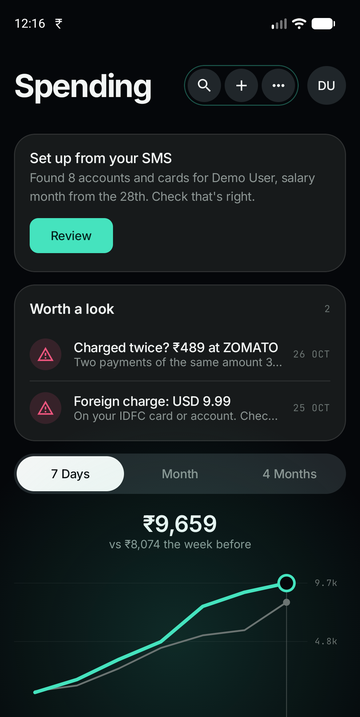 | 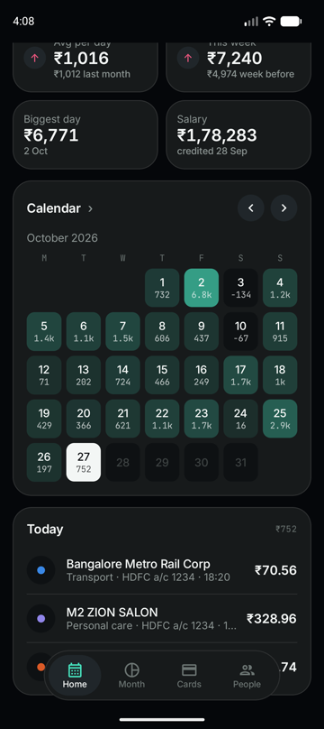 | 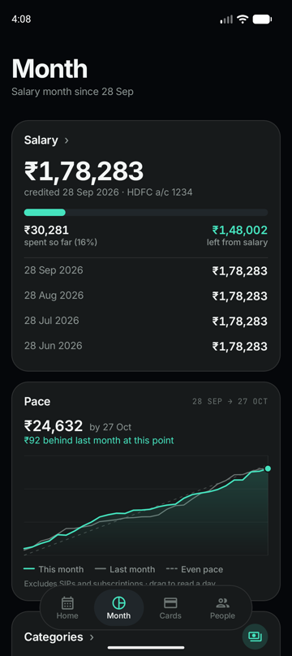 |

| Credit card utilisation | Budgets | Owed to you |
|:-:|:-:|:-:|
| 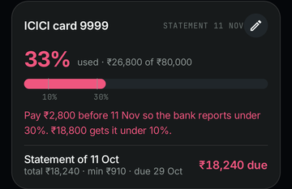 | 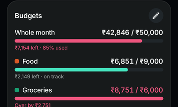 | 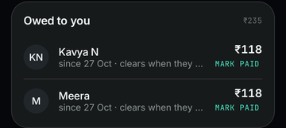 |

| Split a payment | Subscriptions & year | Light theme |
|:-:|:-:|:-:|
| 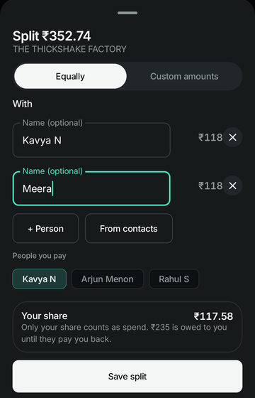 | 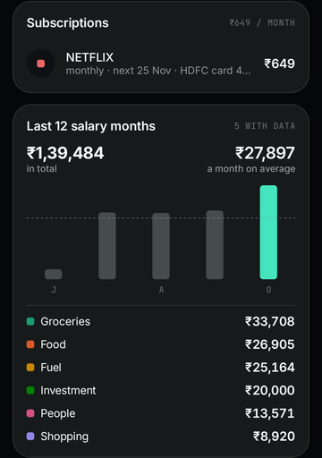 | 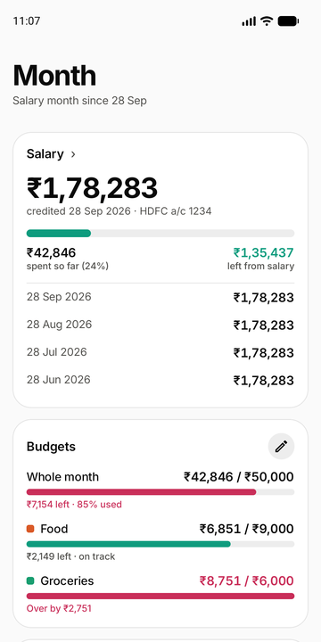 |

| Cards | People | Setup |
|:-:|:-:|:-:|
| 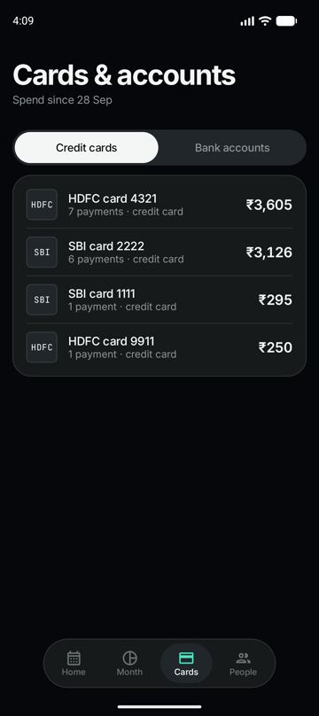 | 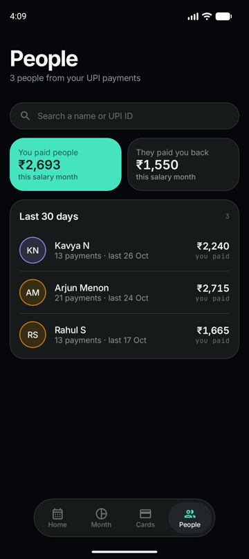 | 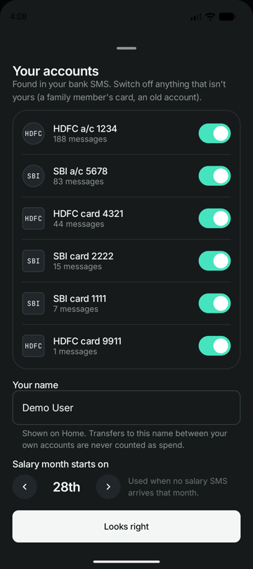 |

---

## Banks

| Exact layouts | Generic rules (≈30 banks) |
|---|---|
| HDFC · SBI · ICICI · DCB | Axis · Kotak · IDFC FIRST · Yes · AU · IndusInd · Bank of Baroda · PNB · Canara · Union · Federal · Indian · IOB · BOI · Central · UCO · IDBI · RBL · Equitas · Bandhan · Karnataka · South Indian · City Union · HSBC · Standard Chartered · Amex · OneCard · Slice · Airtel · Jio |

- **Exact layouts** are tested against real SMS (names and numbers changed).
- **Generic rules** read the common phrasing: amount, debit or credit, account or card, payee, date.
- Anything unsure goes to **More → SMS I couldn't read**. It is never guessed.

---

## Privacy

| | |
|---|---|
| ❌ Internet | No `INTERNET` permission: the app **cannot** send data anywhere |
| ❌ Accounts, ads, analytics | None |
| ❌ Cloud backup | Off. Your own encrypted file is the only backup |
| ✅ SMS read | Only from bank sender IDs; OTPs and promos are skipped |
| ✅ Contacts | Not requested. Picking a contact for a split uses Android's picker |
| ✅ Setup | Nothing hardcoded: accounts, name and salary day are detected on the phone and confirmed by you |

---

## Battery

- No polling, no wake locks
- Wakes only when an SMS arrives, plus one inexact alarm at midnight
- Alerts and the widget update on those same moments

---

## How it works

```
Bank SMS ─► SmsReceiver ─► SQLite (raw SMS only)
                               │
              ┌────────────────┼──────────────────┐
              ▼                ▼                  ▼
          SmsReader        CardFacts          Statement CSV
   (exact + generic rules) (limits, bills)
              │                │                  │
              ▼                ▼                  ▼
          Classifier ──► Dedupe ──► Owe ──► Ledger / Credit / Budgets
                                                   │
                                  Notification · Alerts · Widget · UI
```

- Only raw SMS are stored; every number is recomputed from them, so fixing a parser fixes history too
- Your own accounts and UPI IDs are learned from same-amount transfers between them

---

## Build

Requirements: Android Studio (JDK 17+), Android SDK 37.

```bash
git clone https://github.com/DdarkSaber/Spend.git
cd Spend
./gradlew testDebugUnitTest   # 95 tests: parsers, classifier, credit, budgets, splits, CSV
./gradlew assembleDebug       # app/build/outputs/apk/debug/
```

- Debug builds have **More → Load demo data**
- Release signing reads an untracked `keystore.properties` (`storeFile`, `storePassword`, `keyAlias`, `keyPassword`); without it the release build is unsigned
- `fastlane/metadata/` holds the F-Droid listing text

---

## Credits

- Bank sender codes and SMS phrasings were cross-checked against [PennyWise](https://github.com/sarim2000/pennywiseai-tracker), [hisab-kitab](https://github.com/KrishnaMahajan10/hisab-kitab) and [Smart-spend-tracker](https://github.com/Pradyuman-rajpurohit/Smart-spend-tracker). No code was copied; the parsers and tests here are original.
- Fonts: [Inter](https://rsms.me/inter/) and [JetBrains Mono](https://www.jetbrains.com/lp/mono/) (SIL OFL)

## License

[MIT](LICENSE). Fonts are under the SIL Open Font License; see `FONT-LICENSE-*.txt`.
